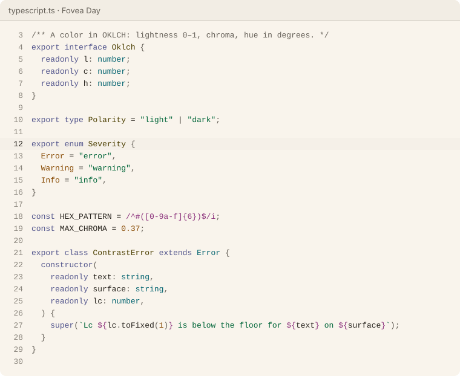
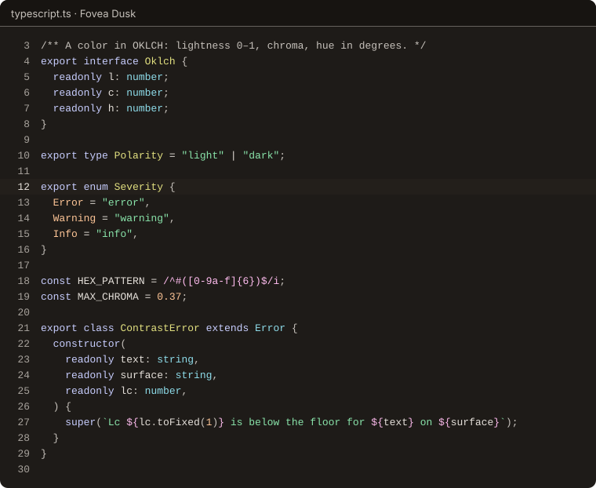
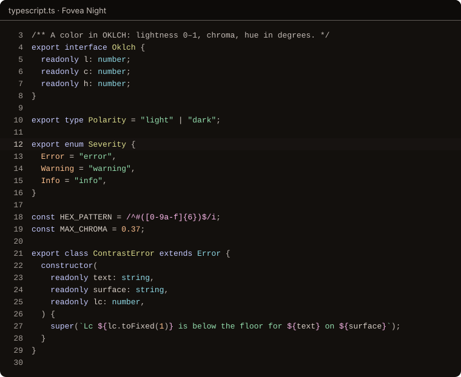

<p align="center"></p>

<h1 align="center">Fovea</h1>

<p align="center">A color scheme informed by vision research. Currently for VS Code, Cursor, VSCodium and Ghostty.</p>

<p align="center"><a href="https://natewave.github.io/fovea/">Website</a> · <a href="docs/design.md">Design</a> · <a href="docs/style-guide.md">Style guide</a> · <a href="CHANGELOG.md">Changelog</a></p>

<p align="center"><a href="https://github.com/natewave/fovea/actions/workflows/ci.yml"></a></p>

| Variant | For |
|---|---|
| **Fovea Day** | Ink on warm paper. The most legible variant for long reading, and the natural match for bright rooms and daylight. |
| **Fovea Dusk** | Soft light on warm graphite, for dim rooms, evenings and anyone who prefers dark mode. |
| **Fovea Night** | Dusk dimmed for dark rooms and late hours: the least light that still meets body-text minimums. |







## Install

### VS Code, Cursor and VSCodium

Fovea isn't on the Visual Studio Marketplace or Open VSX yet. Until it is, clone the repository, build the extension and install the VSIX. You need Git, Node.js 22.18 or newer and pnpm 10:

```sh
git clone https://github.com/natewave/fovea.git
cd fovea
pnpm install
pnpm package:vscode
code --install-extension dist/vscode/fovea.vsix
```

Use `cursor` or `codium` instead of `code` for Cursor or VSCodium. Then run **Preferences: Color Theme** from the Command Palette and pick a variant.

### Recommended settings

Follow the system's light and dark mode, with Day for light and Dusk for dark:

```json
{
  "window.autoDetectColorScheme": true,
  "workbench.preferredLightColorTheme": "Fovea Day",
  "workbench.preferredDarkColorTheme": "Fovea Dusk"
}
```

In dark rooms, use Night instead of Dusk:

```json
{
  "workbench.preferredDarkColorTheme": "Fovea Night"
}
```

The [extension README](ports/vscode/README.md) also shows how to turn on italic comments and colored bracket pairs.

### Ghostty

The themes need Ghostty 1.3 or newer. Copy them into Ghostty's themes folder:

```sh
git clone https://github.com/natewave/fovea.git
cd fovea
mkdir -p ~/.config/ghostty/themes
cp ports/ghostty/themes/* ~/.config/ghostty/themes/
```

Then add this line to your Ghostty config to follow the system's light and dark mode:

```ini
theme = light:Fovea Day,dark:Fovea Dusk
```

Reload the config (`cmd+shift+,` on macOS, `ctrl+shift+,` on Linux) or restart Ghostty. On macOS, Ghostty reads `~/Library/Application Support/com.mitchellh.ghostty/` after `~/.config/ghostty/`, so a `theme` line there wins ([configuration docs](https://ghostty.org/docs/config)).

More options are in the [Ghostty README](ports/ghostty/README.md).

### Other apps

[`ports/palette/fovea.json`](ports/palette/fovea.json) and [`fovea.css`](ports/palette/fovea.css) hold every color in all three variants. The [style guide](docs/style-guide.md) explains how to map an app's settings to Fovea's roles, and [CONTRIBUTING.md](CONTRIBUTING.md#adding-a-port) how to add a port. Themes for the [iTerm2-Color-Schemes](ports/iterm2-color-schemes/README.md) collection are staged but not yet submitted.

## Development

```sh
pnpm install        # Node.js 22.18 or newer, pnpm 10
pnpm build          # regenerate every port from the palette
pnpm test           # palette, color math, generators and ports
pnpm lint           # Biome
pnpm typecheck      # TypeScript, strict
pnpm site:dev       # the website, at http://localhost:4321/
pnpm report         # an internal palette report in dist/report/
```

The palette lives in [`packages/palette`](packages/palette) as OKLCH specs with contrast targets; [`packages/colorlab`](packages/colorlab) holds the color math; [`packages/build`](packages/build) generates every file under [`ports/`](ports) and [`docs/generated/`](docs/generated). Generated files are never edited by hand, and CI fails if they are stale. [CONTRIBUTING.md](CONTRIBUTING.md) has the details, and [`docs/decisions/`](docs/decisions/README.md) records where Fovea departs from its original brief.

Every push to `main` runs the checks and deploys the website to GitHub Pages; [CONTRIBUTING.md](CONTRIBUTING.md#the-website-and-releases) describes the deploy and the release steps.

## License

[MIT](LICENSE). The website's fonts, Atkinson Hyperlegible Next and Mono, are self-hosted from Fontsource under the SIL Open Font License 1.1.
